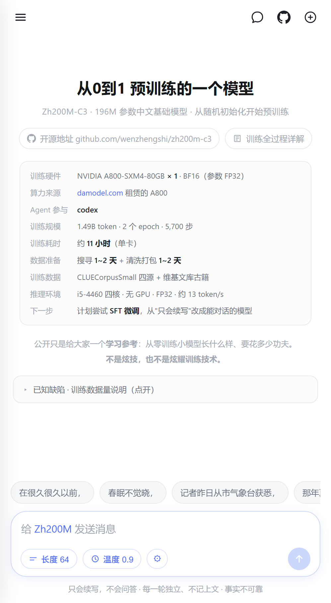
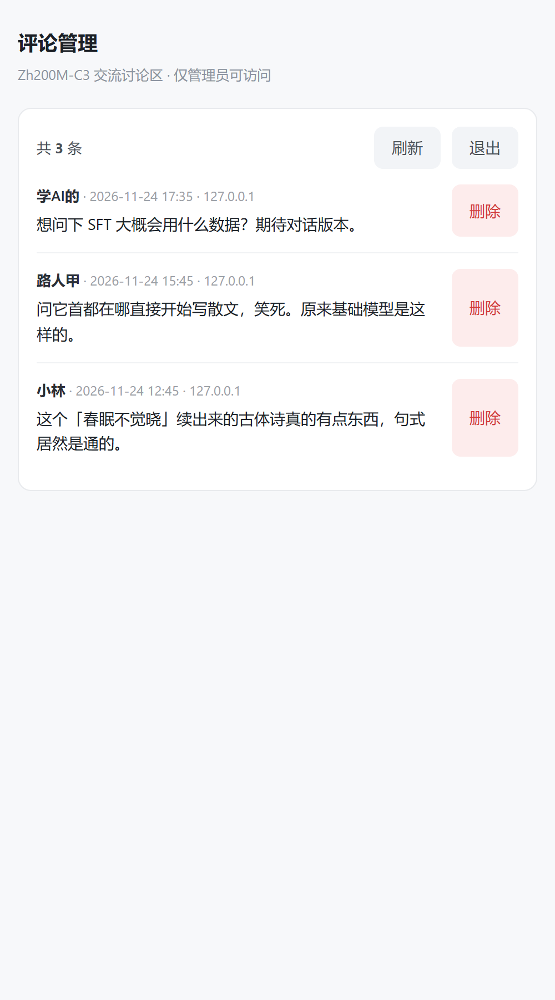

# Web 服务（前后端）

把 `zh200m-c3` 这个 196M 基础模型包成一个可公网访问的 WebSocket API + 网页。
模型**跑在本地机器上**，公网访问靠一台中转服务器做 TLS 终结和反向代理。



## 架构

```
浏览器 / 客户端
      │  wss://your-domain/ws
      ▼
┌──────────────────────────────┐
│ 中转服务器（任意有公网 IP 的机器）│
│  nginx：TLS 终结 + 反代        │
│  ↓ proxy_pass 127.0.0.1:8765  │
│  sshd：反向隧道出口             │
└──────────────────────────────┘
      │  ssh -R 建立的反向通道
      ▼
┌──────────────────────────────┐
│ 本地机器（跑模型的这台）          │
│  uvicorn + FastAPI            │
│  zh200m-c3-196m-fp32.pt       │
│  KV Cache 单并发推理            │
└──────────────────────────────┘
```

不用 frp、不用公网 IP，只要本地能 SSH 连上中转服务器即可。

## 目录

| 文件 | 作用 |
|---|---|
| `ws_server.py` | 后端：WebSocket 推理接口 + 留言板 + 用量限额 + 管理后台 |
| `index.html` | 前端：单文件页面（无构建步骤、无 npm） |
| `test_client.py` | 命令行测试客户端 |
| `run_service.ps1` | Windows 守护脚本：保持推理服务 + SSH 隧道存活 |
| `start_hidden.vbs` | 隐藏窗口启动守护脚本 |
| `install_task.cmd` / `stop_service.cmd` | 注册开机自启 / 停止 |
| `docs/` | 界面截图 |

## 依赖

```bash
pip install torch sentencepiece fastapi uvicorn websockets requests
```

模型权重与分词器的准备见仓库根目录的 README。

## 本地运行

```bash
# 在仓库根目录执行（需要 tokenizer_frozen/tokenizer.model）
python server/ws_server.py --host 127.0.0.1 --port 8765 --threads 4
```

打开 `http://127.0.0.1:8765/` 即可。

> `tokenizer_frozen/` 需要自己建：把 `tokenizer/tokenizer.model` 复制进去即可
> （推理脚本里 `MODEL_PY` / `TOKENIZER_FILE` 是按这个路径找的）。

## 部署到公网

**1. 本地建反向隧道**

```bash
ssh -N -R 127.0.0.1:8765:127.0.0.1:8765 -o ServerAliveInterval=20 root@YOUR_SERVER_IP
```

**2. 中转服务器上配 nginx**

```nginx
server {
    listen 443 ssl http2;
    server_name your-domain.example;

    ssl_certificate     /etc/letsencrypt/live/your-domain.example/fullchain.pem;
    ssl_certificate_key /etc/letsencrypt/live/your-domain.example/privkey.pem;

    location / {
        proxy_pass http://127.0.0.1:8765;
        proxy_http_version 1.1;
        proxy_set_header Upgrade $http_upgrade;
        proxy_set_header Connection "upgrade";
        proxy_set_header Host $host;
        proxy_set_header X-Real-IP $remote_addr;
        proxy_set_header X-Forwarded-For $proxy_add_x_forwarded_for;
        proxy_set_header X-Forwarded-Proto $scheme;
        proxy_read_timeout 300s;
        proxy_buffering off;
    }
}
```

证书可用 `certbot --nginx -d your-domain.example` 申请。

**3. 开机自启（Windows）**

编辑 `start_hidden.vbs` 把 `<PROJECT_DIR>` 换成实际路径，然后把 `.vbs`
放进 `%APPDATA%\Microsoft\Windows\Start Menu\Programs\Startup\`。

这样登录 Windows 后会自动拉起 `run_service.ps1`，它同时看护推理进程和 SSH 隧道，
任一挂掉 10 秒内重启，并带单实例锁、孤儿进程清理和日志轮转。

## 接口

| 方法 | 路径 | 说明 |
|---|---|---|
| WS | `/ws` | 推理主接口 |
| GET | `/api/quota` | 查询本 IP 今日剩余额度 |
| GET | `/api/info` | 协议说明与运行环境 |
| GET | `/stats` | 全局运行状态 |
| GET/POST | `/api/comments` | 留言板读写 |
| GET | `/admin` | 管理后台（密码保护） |

WebSocket 协议：

```json
// 请求
{"type":"generate","prompt":"春眠不觉晓，","max_tokens":64,"temperature":0.9,
 "top_k":40,"top_p":0.9,"repetition_penalty":1.2}

// 响应事件流
{"type":"queued","waiting":1}
{"type":"start"}
{"type":"token","text":"白"}
{"type":"done","text":"……","tokens":48,"ttft":0.09,"elapsed":3.3,"tok_per_s":14.5}
{"type":"error","message":"……"}
```

## 使用限额

| 限制 | 默认 | 环境变量 |
|---|---|---|
| 单 IP 每日请求数 | 120 | `ZH_LIMIT_REQ_PER_IP` |
| 单 IP 每日 token | 12,000 | `ZH_LIMIT_TOKENS_PER_IP` |
| 全站每日请求数 | 3,000 | `ZH_LIMIT_REQ_GLOBAL` |
| 全站每日生成 token | 400,000 | `ZH_LIMIT_TOKENS_GLOBAL` |
| 单 IP 同时连接数 | 3 | `ZH_LIMIT_WS_PER_IP` |

请求开始时扣 1 次，生成结束按实际 token 累加，计数存 SQLite 的 `usage` 表，按天分桶、
重启不清零。管理后台可查看每 IP 用量并单独清零。

## 管理后台



- 地址：`/admin`
- 首次启动会在 `server/admin_password.txt` 自动生成随机密码；改完重启生效
- 功能：留言审核删除、今日用量查看与清零
- 身份用 HMAC 签名的 HttpOnly cookie（7 天），密钥存在 `server/.admin_secret`

## 隐私

- 服务端**只记录用量计数**（IP、请求数、token 数），**不保存用户的提问和生成内容**
- 页面上的「续写记录」只存在浏览器 localStorage 里，不上传

## 已知限制

- 单并发：4 核 CPU 跑 196M 模型，多人使用需要排队
- 本机关机或未登录 Windows 时，公网站点不可用（502）
- 模型是 base model，只会续写、不会问答，事实可靠性低
